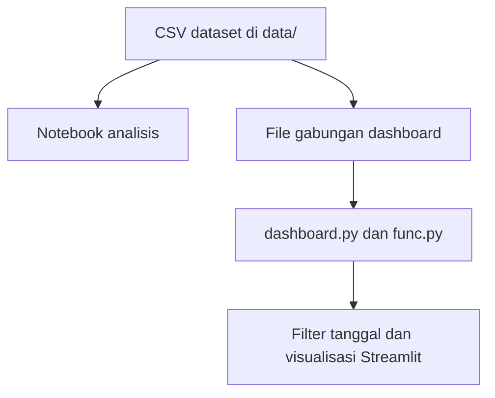

# Analisis Data E-Commerce Publik

Proyek ini menganalisis dataset e-commerce publik dan menyajikan ringkasan melalui notebook serta dashboard Streamlit. Dashboard menyediakan filter rentang tanggal dan visualisasi pesanan, nilai transaksi, produk, ulasan, status pesanan, serta sebaran pelanggan.

## Pratinjau dashboard


## Alur data



## Menjalankan dashboard

Dashboard mengharapkan file `merge_data.csv` dan `geolocation_dataset.csv` berada di folder `dashboard/`. Kedua file tersebut ada di repository.

```bash
python -m venv .venv
```

Aktifkan virtual environment, lalu jalankan dari root repository:

```bash
pip install -r requirements.txt
cd dashboard
streamlit run dashboard.py
```

## Isi repository

- `Data_Analysis_Project.ipynb`: proses analisis dan visualisasi.
- `data/`: file CSV dataset publik.
- `dashboard/dashboard.py`: antarmuka dashboard.
- `dashboard/func.py`: fungsi agregasi data dan peta.
- `dashboard/merge_data.csv` dan `dashboard/geolocation_dataset.csv`: input yang dibaca dashboard.
- `requirements.txt`: dependency Python.

Notebook membahas proses pengumpulan, pemeriksaan, pembersihan, dan eksplorasi data. Dashboard merangkum tren harian, pengeluaran, kategori produk, rating ulasan, status pesanan, dan geolokasi.
